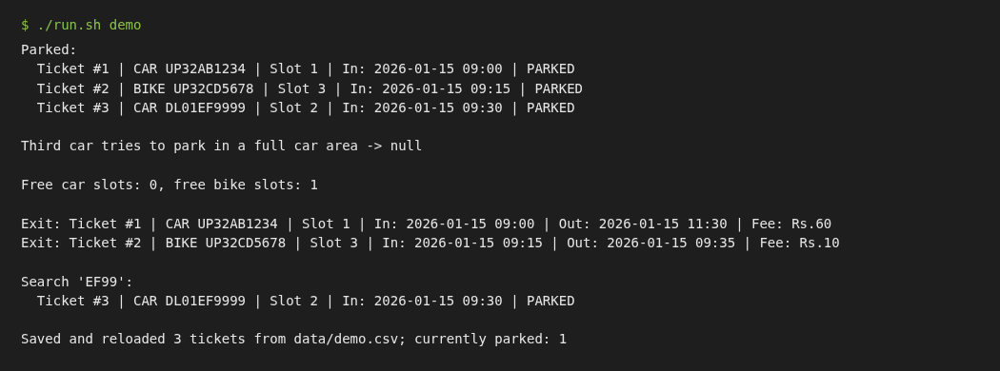

# Car Parking System

A simple **console-based parking lot manager written in Java 17** (no external libraries).
Vehicles get a ticket when they enter, and the fee is calculated by hours when they leave.
Data is saved to a CSV file so nothing is lost when the program closes.

> Built as a 3rd-year B.Tech mini project to practise OOP (classes, enums, collections) and file handling in Java.

## Features

- Separate slots for **cars** and **bikes** (default: 5 each, easy to change in `Main.java`)
- **Park a vehicle** - gets the first free slot of its type, an auto-generated **ticket id** and **entry time**
- **Exit a vehicle** - fee is calculated from the ticket
  - Car: Rs.20 / hour, Bike: Rs.10 / hour
  - Any started hour counts as a full hour, minimum 1 hour (e.g. 2h 30m = 3 hours)
- **Show available slots** per vehicle type
- **Search by vehicle number** (case/space-insensitive, partial match works) - shows current and past tickets
- **Save / load to CSV** (`data/parking.csv`), auto-loaded on start and auto-saved on quit
- Blocks duplicate parking of the same vehicle and parking in a full lot
- Simple tests (no JUnit needed) and a demo program

## Screenshot

Output of the demo program (`./run.sh demo`):



## Project structure

```
car-parking-system/
├── src/parking/
│   ├── Main.java          # console menu (run this)
│   ├── Demo.java          # non-interactive demo
│   ├── ParkingLot.java    # park / exit / search / availability logic
│   ├── ParkingSlot.java   # one slot (type + current ticket)
│   ├── Ticket.java        # ticket id, entry/exit time, fee
│   ├── Vehicle.java       # vehicle number + type
│   ├── VehicleType.java   # CAR / BIKE with hourly rates
│   ├── FeeCalculator.java # hour-based fee rule
│   └── CsvStorage.java    # save/load CSV
├── test/SimpleTests.java  # simple self-written tests
├── data/                  # parking.csv is created here
└── run.sh                 # build & run helper
```

## How to run

You need **JDK 17 or newer** (`javac -version` to check).

```bash
git clone <your-repo-url>
cd car-parking-system

./run.sh          # build and start the interactive menu
./run.sh demo     # run the scripted demo
./run.sh test     # run the simple tests (21 checks)
```

Without the script (works on Windows too):

```bash
mkdir out
javac -d out src/parking/*.java test/SimpleTests.java
java -cp out parking.Main
java -cp out;. SimpleTests      # tests (use ':' instead of ';' on Linux/Mac)
```

### Sample CSV (`data/parking.csv`)

```
ticketId,vehicleNumber,type,slotNumber,entryTime,exitTime,fee
1,UP32AB1234,CAR,1,2026-10-29T21:54:06,2026-10-29T23:10:00,40
2,DL1XY55,BIKE,6,2026-10-29T21:54:07,,0
```
An empty `exitTime` means the vehicle is still parked.

## Possible improvements

- Take slot counts and rates from a config file
- Add a GUI (JavaFX/Swing) or a web front end
- Store data in a SQL database (MySQL/SQLite) via JDBC instead of CSV
- Daily revenue report

## License

MIT - see [LICENSE](LICENSE). Author: Mohd Nadeem
